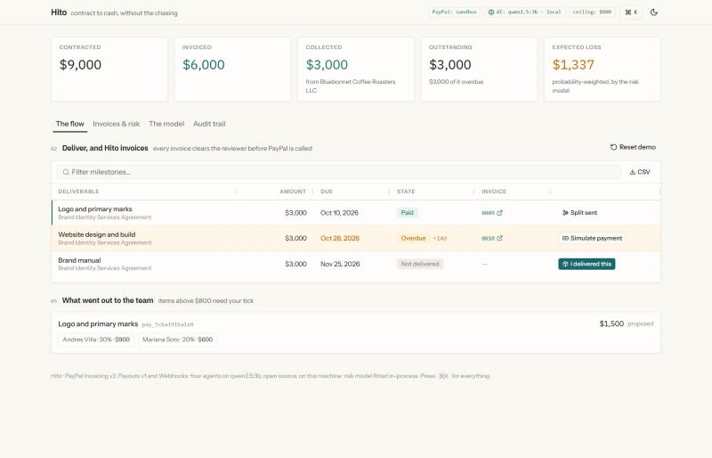
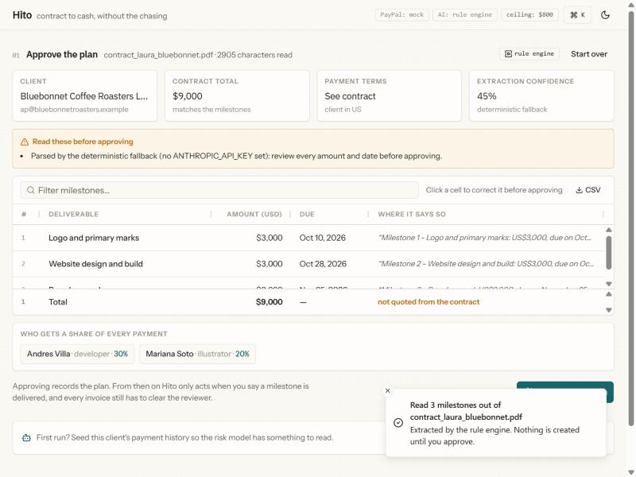
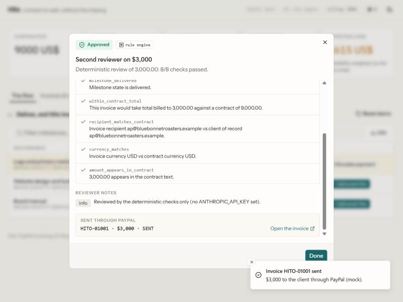
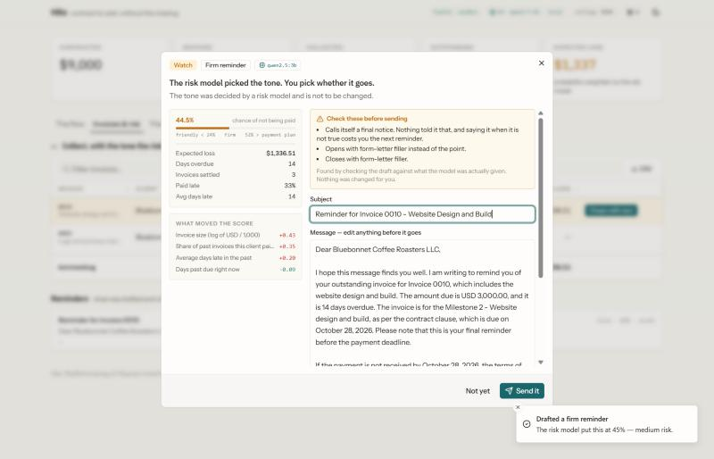
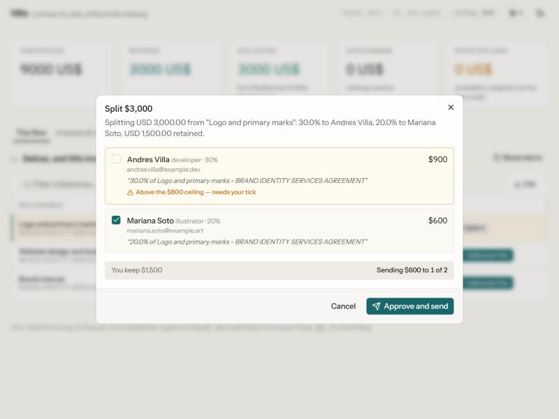
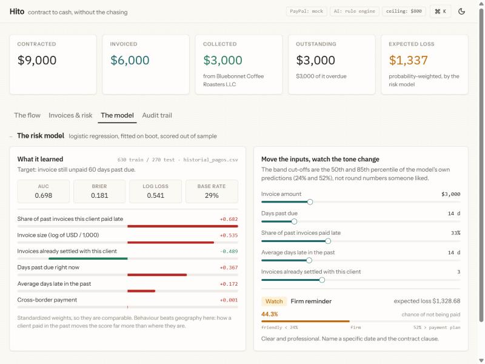

# Hito

**Contract to cash for freelancers, on PayPal.** Hito reads the contract,
invoices each milestone, works out how likely it is that an invoice never gets
paid, asks for the money in the register that probability deserves, and splits
what arrives among the people who helped.

Built for the [PayPal AI Hackathon](https://paypalaihackathon.devpost.com/).

```bash
pip install -r requirements.txt
uvicorn app.main:app
# open http://localhost:8000 and press "Use the sample contract"
```

That is the whole setup. **No PayPal account, no API key and no Node are needed
to run the full flow** — Hito ships an in-process PayPal gateway and a
deterministic agent engine, and the header says which mode is live at all
times. Add credentials to `.env` and the same screens drive the real PayPal
sandbox and Claude.



---

## The problem

Laura is a designer in Medellín. A client in Texas hires her to build their
brand for US$9,000, paid in three parts: US$3,000 for the logo, US$3,000 for
the website, US$3,000 for the brand manual. She works with two friends — a
developer and an illustrator — who are owed a share of each payment.

Today she does all of it by hand. She reads the contract, creates each PayPal
invoice, sends it when she finishes that part, checks whether the client paid,
writes an awkward "hi, just a reminder…" when they are late, and at the end
transfers her friends what they are owed. It is tedious, she forgets things,
and asking for money makes her uncomfortable.

That last part is the expensive one. The uncomfortable email gets delayed,
then softened, then sent to a client who has already learned that being late
costs nothing. **Freelancers do not lose money because they cannot invoice.
They lose it because collection is an emotional task performed by the person
who is owed.** Hito takes the emotion out by making the tone a consequence of
the risk, not of how brave Laura feels that morning.

---

## The five moments

| | What happens | Where |
| --- | --- | --- |
| **1** | **Reads the contract.** Laura drops in the PDF. Hito pulls out every deliverable, its amount, its due date, the sentence in the contract that says so, and the collaborator shares — then flags what is vague before she agrees to it. She approves the plan; nothing exists until she does. | [`app/agents/contract_parser.py`](app/agents/contract_parser.py) |
| **2** | **Invoices when she delivers.** She marks the logo delivered. Before PayPal is called, a second, independent reviewer checks the invoice against the contract. Only then does Hito create and send the real PayPal invoice. | [`app/agents/reviewer.py`](app/agents/reviewer.py) |
| **3** | **Notices the money.** The client pays; the PayPal webhook arrives, the signature is verified, the milestone flips to paid and the dashboard updates. | [`app/main.py`](app/main.py) |
| **4** | **Collects, with tact.** When an invoice goes past due, a risk model estimates the probability it is never paid and *that* picks the register: a nudge, a firm reminder with a date, or an offer to split the balance in two. Claude writes inside that decision. Laura edits and presses send. | [`app/risk/model.py`](app/risk/model.py), [`app/agents/collector.py`](app/agents/collector.py) |
| **5** | **Splits it.** 30% to the developer, 20% to the illustrator, through PayPal Payouts. Amounts are computed in Python to the cent; anything above the approval ceiling is not sent until Laura ticks that specific line. | [`app/agents/splitter.py`](app/agents/splitter.py) |

| | |
| --- | --- |
|  |  |
| **1 · The plan, before she approves it.** Every milestone carries the sentence from the contract it came from, in an editable grid, with the warnings on top. | **2 · The reviewer.** Seven deterministic checks plus an independent Claude pass, before PayPal is ever called. |
|  |  |
| **4 · The tone is the risk, and the draft gets checked too.** 44.5% lands in the middle band, so the draft is firm. Above it, the three things the model made up — it called a first reminder "final" and reached for form-letter filler. Caught, shown, not rewritten. | **5 · The ceiling.** $900 is above the limit and is not sent until Laura ticks that line. $600 is not. |



*The model tab: fitted weights, out-of-sample metrics, and a what-if panel
where moving the inputs flips the tone decision live.*

---

## What makes it more than a wrapper

**The agent that writes the invoice is never the agent that approves it.**
Before any PayPal call, `reviewer.py` runs seven deterministic checks in Python
(does the amount match the approved plan, is this milestone already invoiced,
would this take the project past the contract total, is the recipient the
client of record, does the currency match, is the amount actually in the
contract text) *and* a separate Claude pass that reads the contract and answers
a different question: does this invoice match what the client agreed to pay
for? The policy is in `reviewer.decide()`:

- a deterministic failure → **BLOCK**: nothing is created, full stop
- Claude objects → **HOLD**: Laura sees the objection, the quoted contract
  clause, and can override with one click
- both agree → **APPROVE**: the invoice goes out

Try it in the demo: edit a milestone amount to $4,500 before approving the
plan, then deliver it. The deterministic check catches that it no longer
matches the plan, and with a Claude key the reviewer quotes the line of the
contract that says $3,000.

**Tone is a risk decision, not a style choice.** `app/risk/model.py` is a
logistic regression fitted in pure Python at startup on ~900 historical
invoices, scored out of sample (AUC ≈ 0.70, Brier ≈ 0.18 against a 29% base
rate), and it is the thing that picks the register. Its features are behaviour
Hito observed in its own ledger — how many invoices this client has settled,
how often late, how late, how big this one is, how long it has been overdue.
The band cut-offs are the 50th and 85th percentile of the model's own
predictions rather than round numbers, so the policy travels with the data.
The **Model** tab shows the fitted weights, the metrics and a what-if panel
where you can move the inputs and watch the tone flip from friendly to firm to
payment plan. `GET /api/risk/model` returns the same card as JSON.

(This is the risk-model part of the brief, built on the logistic-regression
material from the SI4006 course. One honest finding: cross-border barely
survives fitting — behaviour beats geography by an order of magnitude.)

**The model never touches the arithmetic.** Every amount — the split, the
remainders, the payment-plan instalments — is computed in Python with
`Decimal` and reconciled so the payouts can never exceed the payment
(`splitter.compute_split`, tested in `tests/test_guardrails.py`). Claude is
given the finished numbers and writes the part it is good at: the note each
collaborator sees, the reminder to the client.

**An agent that can move money has a visible ceiling.** Payout items at or
below `PAYOUT_APPROVAL_THRESHOLD_USD` (default $800) go out on one
confirmation. Anything above it comes back flagged and is simply not sent
unless Laura ticks that line — in the UI, in the API, and over MCP. In the
sample contract, the developer's $900 needs a tick and the illustrator's $600
does not.

**Everything is auditable.** Every decision is written to one ledger with
`actor='agent'` or `actor='human'`, and the **Audit trail** tab is that table.
Beside it, the **Agent log** records every model call with its engine, latency,
token counts and cost — so "is this really calling a model?" has a numeric
answer.

---

## Architecture

```
contract PDF
     │
     ▼
┌─────────────────┐   proposes          ┌──────────────────────┐
│ contract_parser │ ──────────────────▶ │  Laura approves      │
└─────────────────┘                     └──────────┬───────────┘
                                                   │ milestone delivered
                                                   ▼
                        ┌──────────────────────────────────────┐
                        │  reviewer: 7 python checks + Claude   │
                        │  BLOCK / HOLD / APPROVE               │
                        └──────────────────┬───────────────────┘
                                           │ approve
                                           ▼
                            PayPal Invoicing v2  ──▶ client
                                           │
                        INVOICING.INVOICE.PAID webhook (verified)
                                           │
                 ┌─────────────────────────┴─────────────────────┐
                 ▼                                               ▼
    ┌─────────────────────────┐                   ┌──────────────────────────┐
    │ risk model → tone band  │                   │ splitter: Decimal maths  │
    │ collector writes inside │                   │ + approval ceiling       │
    └───────────┬─────────────┘                   └────────────┬─────────────┘
                │ Laura sends                                  │ Laura approves
                ▼                                              ▼
      PayPal invoice reminder                         PayPal Payouts v1
```

| Layer | Choice | Why |
| --- | --- | --- |
| Backend | FastAPI + SQLite, no ORM | `pip install` + `uvicorn` and it runs. The schema is 9 tables in one file. |
| Agents | Qwen2.5 3B Instruct (Apache-2.0) locally via Ollama, Claude optional | Open source, free to run, and the contract never leaves the machine. Both backends are schema-constrained, so the agents never parse prose. |
| Risk | Logistic regression in pure Python | No numpy, no scikit-learn, ~25 ms to fit at boot, and the whole thing is auditable in 240 lines. |
| Frontend | Vite + React + Tailwind + shadcn/ui (Base UI), AG Grid Community, Sonner, cmdk, NumberFlow | Compiled to `app/static` and **committed**, so judges need no Node. |
| Payments | PayPal Invoicing v2, Payouts v1, Webhooks v1 | The three APIs the product actually needs. |

---

## PayPal, specifically

All in [`app/paypal/client.py`](app/paypal/client.py), with idempotency keys on
everything that moves money:

| API | Used for |
| --- | --- |
| `POST /v1/oauth2/token` | Client-credentials auth, token cached until expiry |
| `POST /v2/invoicing/generate-next-invoice-number` | Invoice numbering |
| `POST /v2/invoicing/invoices` | Create the milestone invoice |
| `POST /v2/invoicing/invoices/{id}/send` | Send it to the client |
| `GET /v2/invoicing/invoices/{id}` | Read back status |
| `POST /v2/invoicing/invoices/{id}/remind` | Deliver the collection message, with the payment link attached |
| `POST /v1/payments/payouts` | Pay the collaborators in one batch |
| `GET /v1/payments/payouts/{batch_id}` | Batch status |
| `POST /v1/notifications/verify-webhook-signature` | Verify every incoming webhook |

[`app/paypal/mock.py`](app/paypal/mock.py) implements the same interface
in-process, including a payer page at `/mock/invoice/{id}` with a working Pay
button, so the entire loop is demonstrable without an account. Which one is
active is decided once, in `app/paypal/__init__.py`, and shown in the header.

---

## The AI engine: open source, on your machine

Hito's default engine is **Qwen2.5 3B Instruct** — Apache-2.0, open source, run
locally through [Ollama](https://ollama.com). No account, no API key, no
per-token bill, and **the contract never leaves the laptop**, which for a
document carrying a client's legal name, address and fee schedule is the right
default rather than a feature. Claude is supported and is a drop-in swap, but
it is opt-in. Full rationale, benchmark and limitations:
[`docs/OPEN_MODEL.md`](docs/OPEN_MODEL.md).

```bash
ollama pull qwen2.5:3b     # ~2 GB, once. Hito finds it by itself.
```

Four agents, all through one wrapper ([`app/agents/llm.py`](app/agents/llm.py)):

| Agent | Does |
| --- | --- |
| `contract_parser` | Reads the contract into a payment plan, with the contract sentence behind every milestone and warnings about what is vague |
| `reviewer` | Independently checks each invoice against the contract and objects, quoting the clause |
| `collector` | Writes the collection message *inside* the tone the risk model chose, in the client's language |
| `splitter` | Writes the payout copy around amounts it is forbidden to change |

Implementation notes that matter:

- **Structured outputs everywhere.** Every agent is called with a JSON schema
  the output must satisfy — Ollama's `format` field, Claude's
  `output_config.format`. The backend never parses prose and never repairs
  malformed JSON, and the agents do not know which engine answered.
- **Three backends, one contract.** Local model → Claude (if a key is set) →
  deterministic rule engine, falling through on failure. Pin one with
  `HITO_LLM_PROVIDER`.
- **Every agent has a deterministic twin.** With no model at all the product
  still works end to end, and the UI labels it `rule engine` rather than
  pretending. This is why the demo cannot dead-end, and why a judge who has not
  installed Ollama still sees the whole flow.
- **Measured, not asserted.** `scripts/eval_parser.py` scores the contract
  reader field by field against three contracts — a tidy PDF, a Spanish one
  with `US$3.000` notation and dates in words, and an English one written in
  prose. The deterministic engine manages 17/24 and collapses to 2/8 on prose;
  the local model gets 24/24. Numbers, hardware and limitations:
  [`docs/OPEN_MODEL.md`](docs/OPEN_MODEL.md).
- **The model's output is checked, not trusted.** A small model will write
  things that were never true: on the first run it told a client this was the
  final reminder, offered a payment plan that was not on the table, and pointed
  at an attachment that does not exist. `collector.review_draft()` checks the
  finished text against what the model was actually given, and
  `reviewer.verify_evidence()` drops any quoted contract clause that cannot be
  found in the contract. Findings go to Laura; nothing is rewritten behind her.
- **Observability**: engine, model, latency, token counts and cost are recorded
  per call in `agent_runs` and shown in the Agent log tab.

---

## Hito as an MCP server

The web app is one client of the API. The other is
[`app/mcp_server.py`](app/mcp_server.py): a Model Context Protocol server over
stdio exposing the whole flow as 11 tools (`read_contract`, `approve_plan`,
`invoice_milestone`, `score_risk`, `draft_reminder`, `send_reminder`,
`propose_split`, `send_payout`, …), so any MCP-speaking agent can run a
freelancer's billing.

The guardrails hold there too, because they live in the service rather than in
the UI: `invoice_milestone` still has to clear the reviewer, and `send_payout`
refuses flagged items that no human approved — there is a test for exactly
that (`tests/test_mcp.py::test_the_full_loop_over_mcp_keeps_the_payout_ceiling`).
Setup: [`docs/MCP.md`](docs/MCP.md). Zero dependencies — MCP stdio is
newline-delimited JSON-RPC.

---

## Running it

### The 30-second version

```bash
pip install -r requirements.txt
uvicorn app.main:app
```

Open <http://localhost:8000>, press **Seed history** then **Use the sample
contract**, and walk the five steps. `⌘K` / `Ctrl+K` opens a command palette
with every action.

### With your own PayPal sandbox and Claude

```bash
cp .env.example .env     # then fill it in
python scripts/check_credentials.py
```

`check_credentials.py` tests each credential separately and tells you exactly
what works, printing no secrets. You need:

1. A [PayPal developer account](https://developer.paypal.com/dashboard/) →
   create a sandbox REST app → `PAYPAL_CLIENT_ID` / `PAYPAL_CLIENT_SECRET`.
2. `PAYPAL_INVOICER_EMAIL` — the sandbox **business** account that issues the
   invoices. PayPal rejects invoices from anyone else.
3. The AI engine. Hito's default needs no key — install
   [Ollama](https://ollama.com/download) and run `ollama pull qwen2.5:3b`.
   Only set `ANTHROPIC_API_KEY` if you would rather run on Claude.
4. Optional: a webhook subscribed to `INVOICING.INVOICE.PAID` pointing at
   `https://<your-tunnel>/api/webhooks/paypal`, and its id in
   `PAYPAL_WEBHOOK_ID`. With the id set, every webhook signature is verified
   and unverified ones are rejected with a 401. Without it, the app still
   accepts webhooks and labels them `UNVERIFIED` in `webhook_log`.

```bash
# exposing the webhook endpoint during a demo
ngrok http 8000
```

One thing the UI will nag you about: on the approval screen, set **Client —
invoices go here** to your sandbox **buyer** address. The sample contract's own
address is a placeholder, and PayPal will happily accept an invoice that
reaches nobody. Then seed the client history *after* approving, so it is
recorded against that same address — the risk model looks history up by email.

Verified against the real sandbox: OAuth2, invoice-number generation, invoice
create, invoice send, the payer-view link, the reminder call, and a Payouts
batch settling to `SUCCESS`. Webhook signature verification is the one path
that needs a public tunnel and `PAYPAL_WEBHOOK_ID` to exercise; without it,
**Simulate payment** runs the identical code path.

### Working on the frontend

```bash
cd web
npm install
npm run dev     # proxies /api to localhost:8000
npm run build   # writes ../app/static, which is committed
```

> On a machine where Windows Application Control blocks unsigned native
> modules, the build uses the WebAssembly build of Rollup — that is the
> `overrides` entry in `web/package.json`.

### Tests

```bash
python -m pip install -r requirements-dev.txt
python -m pytest tests -q
```

61 tests covering the risk model's behaviour (monotonicity, calibration, band
policy), the guardrails (every blocking check, the exact-cent split, the
approval ceiling), the engine layer (backend selection, falling through to the
deterministic twin, never labelling a fallback as a model, fitting a contract
into a local model's context window), the whole HTTP flow, webhook handling,
the audit trail, and the MCP server.

### Deploying

`render.yaml` is a working Render blueprint. It deploys with no secrets at all
— in-process PayPal gateway, deterministic engine, both labelled in the header
— so a judge can click through the whole flow without installing anything. Fill
the environment variables in the Render dashboard to point it at your real
sandbox. There is also a `Dockerfile` for anywhere else. The frontend is
pre-built and committed, so neither needs Node.

Worth saying plainly: **the hosted demo runs the rule engine, not the model.**
A ~2 GB open-source model does not fit a free Render instance, and Hito's whole
argument for that model is that it runs on the freelancer's own machine. The
hosted URL is the no-install path; `ollama pull qwen2.5:3b` locally is the
real one. (Setting `ANTHROPIC_API_KEY` in the Render dashboard is the other way
to give the hosted demo a real model.)

---

## Repository map

```
app/
  main.py              FastAPI: the five moments as HTTP, the audit trail, the mock payer page
  db.py                SQLite schema and the event/agent-run ledger
  config.py            .env loading and which mode is live
  agents/
    llm.py             the one path to a model: local open-source first, Claude optional, rules always
    contract_parser.py agent 1 + a real regex fallback that handles US$3,000 / 3.000 / "October 10, 2026"
    reviewer.py        agent 2 + the seven deterministic checks and the BLOCK/HOLD/APPROVE policy
    collector.py       agent 3 + three hand-written templates, one per tone band, in English and Spanish
    splitter.py        agent 4 + exact-cent Decimal split and the approval ceiling
  risk/model.py        the logistic regression, its metrics and its model card
  paypal/
    client.py          the real REST client
    mock.py            the in-process stand-in with the same interface
  mcp_server.py        the whole flow as MCP tools over stdio
  static/              the built frontend (committed)
web/                   the frontend source
data/
  historial_pagos.csv  the 900-row payment history the model learns from (seeded generator)
  contract_laura_*.pdf the sample contract (generated, real text layer)
docs/                  the open-model rationale and benchmark, demo script, MCP
                       and APIMatic setup, openapi.json
scripts/
  check_credentials.py one-command credential and engine smoke test
  eval_parser.py       scores the contract reader against three known contracts
  make_dataset.py      regenerates the training data, seeded
  make_demo_pdf.py     regenerates the sample contract PDF, no PDF library
  export_openapi.py    writes docs/openapi.json from the live app
tests/                 61 tests
```

## Sponsor tools used

| Tool | Where |
| --- | --- |
| **PayPal** | Invoicing v2, Payouts v1, Webhooks — `app/paypal/client.py` |
| **Qwen2.5 3B Instruct (Apache-2.0)** | the default engine for all four agents, run locally through Ollama with JSON-schema-constrained outputs — `app/agents/llm.py`, `docs/OPEN_MODEL.md` |
| **Claude (Anthropic)** | optional drop-in engine for the same four agents — `app/agents/llm.py` |
| **AG Grid Community** | every table: the editable plan-approval grid, the milestone grid with in-row actions, the risk-sorted invoice grid with a custom meter renderer and pinned totals, the audit trail and the agent log — `web/src/components/grids.tsx` |
| **APIMatic** | `docs/openapi.json` is generated from the live app and imported to produce SDKs and a docs portal — `docs/APIMATIC.md` |
| **Render** | `render.yaml`, deploys with or without secrets |

## License

MIT — see [LICENSE](LICENSE).
